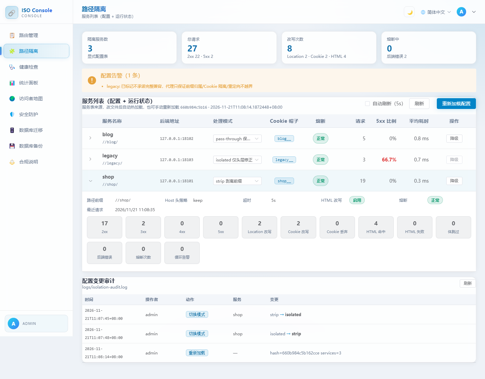

# 反向代理路径隔离网关 · 部署与运维说明

> 本模块是 GatewayHub 的「路径隔离」转发层：按路径第一段 `/{服务名}/` 路由到后端，
> 每个请求执行一次 **拦截 → 修正 → 转发 → 响应修正**，处理完即结束（无跨请求状态）。
> 配置表在 `isolation.yaml`（显式声明），代码只实现规则、不认识任何具体服务。

---

## 1. 处理模型（单循环、确定性）

| 阶段 | 做什么 | 关键约束 |
|---|---|---|
| 拦截 | 取路径第一段匹配服务名 | 未命中 **404**，不猜测归属 |
| 请求修正 | 路径剥离/保留、Host 策略、注入 `X-Forwarded-*`、Cookie 脱帽 | 每个请求只修正一次 |
| 转发 | 单次转发到 `target` | 绝不因响应内容二次发起请求 |
| 响应修正 | `Location`、`Set-Cookie`、可选 HTML/CSS 字面量 | 只修正一次，不形成代理内部回环 |

三种模式（`mode`）：

| 模式 | 路径 | 响应体 | 适用 |
|---|---|---|---|
| `pass-through` | 原样传 `/{服务名}/...` | 永不改 | 后端自己认前缀（Java context-path 等） |
| `strip` | 剥离前缀，后端看到 `/...` | 可按开关改字面量 | 普通 Go/Node/静态站 |
| `isolated` | 剥离前缀 | **永不改**（仅头层） | 出问题时的降级档位 |

> `isolated` 是「安全档」：所有改写开关在此模式下自动失效（代码层面强制，不靠配置自觉）。

---

## 2. 部署

### 2.1 开关（config.yaml）

```yaml
isolation:
  enabled: true            # 关掉则完全走原有 DB 路由逻辑
  file: isolation.yaml     # 服务配置表
  watch: true              # 文件变更热加载（约 5s）
  watch_interval: 5        # 轮询间隔（秒）
  audit_file: logs/isolation-audit.log   # 变更审计（JSONL）
  trust_proxies: false     # 网关前面还有可信反代才设为 true（决定客户端 IP 取值）
```

`isolation.yaml` 缺失或格式错误时：**记录 config_error 并保持未启用**，不影响网关控制台与其他路由。

### 2.2 路由优先级

```
/api/*（网关控制台）                  ← 最高，服务名禁止占用 api/assets/static/favicon/health/isolation/login
/{服务名}/...（isolation.yaml 声明）   ← 优先于 DB 路由
DB 路由（控制台「路由管理」）           ← 原有能力，未声明进 isolation.yaml 的服务继续走这里
SPA 前端回退
```

> 注意：一旦 `isolation.yaml` 声明了至少一个服务，网关就视为「路径空间已显式声明」，
> 不再启用原有的「子路径部署前缀猜测」——未声明的多段路径直接 404（NFR-5 不猜测归属）。
> 若网关部署在 `https://example.com/gw/` 之后，请在反代侧剥离 `/gw`。
> 未声明任何服务时，原有行为完全不变。

### 2.3 端口与日志

- 监听端口：`server.port`（默认 `8088`），与网关同一进程、同一端口。
- 业务访问日志：`access_log.dir`（既有能力，按天/小时落盘）。
- 隔离网关审计：`isolation.audit_file`，JSON Lines，每次 reload / 模式切换一条。
- 诊断日志：进程 stdout，统一前缀 `[isolation][分类][服务名]`。

---

## 3. 运维接口（需管理员 JWT）

| 方法 | 路径 | 说明 |
|---|---|---|
| GET | `/api/isolation/services` | 每个服务的配置 + 熔断状态 + 指标（FR-19） |
| GET | `/api/isolation/metrics` | 纯指标快照（便于外部监控抓取） |
| GET | `/api/isolation/audit?limit=50` | 最近变更审计 |
| PATCH | `/api/isolation/services/:name/mode` | 一键切模式，body `{"mode":"isolated"}` |
| POST | `/api/isolation/reload` | 立即重新加载 `isolation.yaml`（失败保留原配置） |

一键降级示例：

```bash
curl -X PATCH http://127.0.0.1:8088/api/isolation/services/SPA/mode \
  -H "Authorization: Bearer $TOKEN" -H "Content-Type: application/json" \
  -d '{"mode":"isolated"}'
```

### 3.1 控制台页面（无需 curl）

管理员控制台左侧「🧩 路径隔离」页把上述接口做成可视面板：

- **概览卡**：服务数、总请求量、改写总次数（Location/Cookie/HTML 分项）、熔断中的服务数。
- **服务表**：每个服务的后端、`处理模式`（下拉即改，切 `isolated` 需二次确认）、Cookie 帽子、熔断状态、请求量、5xx 比例、平均耗时；行首可展开看 13 项细分指标、Host 策略、超时、已知绝对路径前缀。
- **降级按钮**：一行一个，等价于 `PATCH .../mode`，点击即生效并写审计。
- **配置告警**：`isolation.yaml` 校验产生的 Warnings（如 `html_rewrite` 在非 strip 模式无效、帽子互为前缀）在页面顶部常驻提示。
- **变更审计**：reload / 模式切换的时间、操作者（JWT 用户名）、服务、`from → to`。
- 服务表每 5 秒自动刷新，可关闭；`重新加载配置` 按钮用于改完 `isolation.yaml` 后立即生效（文件监听本身也会热加载）。

> 页面只是这些接口的视图，**不承担任何网关逻辑**：所有改写、熔断、隔离行为仍在 Go 侧，关掉前端不影响代理功能。



---

## 4. 指标与告警口径

按服务统计（`GET /api/isolation/metrics`）：

| 指标 | 含义 | 排障用法 |
|---|---|---|
| `requests` / `status_4xx` / `status_5xx` | 请求量与错误比例 | 5xx 高 → 后端问题；4xx 高 → 路由/鉴权语义问题 |
| `backend_errors` | **代理**发不出请求（连接拒绝/超时） | 与 5xx 区分：这类是「后端不可达」 |
| `location_rewrites` | `Location` 改写次数 | 突增往往意味着后端在换重定向策略 |
| `cookie_rewrites` / `cookies_dropped` | 加帽/丢弃次数 | 登录态异常时先看这两项 |
| `html_hits` / `html_failures` / `body_skipped` | 字面量改写命中/失败/跳过 | 失败多为 gzip/br 编码或体积超限 |
| `breaker_trips` | 熔断触发次数 | 结合 `breaker.state` 判断是否自动降级 |
| `loop_alerts` | 重定向循环告警次数 | 通常对应后端 bug，或后端自带 base path 却用了 strip |
| `abs_prefix_hits` | **越界归因**次数：请求未带服务前缀、但命中该服务声明的 `known_abs_prefixes`（已 404） | >0 基本等于「这个后端没配 base path」，见 §4.1 |

日志分类（FR-18，责任边界一眼可辨）：

| 分类 | 责任方 | 典型内容 |
|---|---|---|
| `backend_bug` | 后端 | 非法 `Set-Cookie`、连接拒绝、超时 |
| `rewrite_failed` | 代理 | gzip 解压失败、体积超限、编码不支持 |
| `config_error` | 配置 | YAML 解析失败、字段非法、热加载失败、`known_abs_prefixes` 越界归因、配置导致的重定向自环 |
| `proxy_degrade` | 代理（主动） | 熔断打开、服务被禁用 |
| `redirect_loop` | 后端（多为 bug） | 同一来源短时间反复 3xx |
| `rewrite_ok` | 代理（正常） | 命中数与响应大小 |

---

## 4.1 服务接入三级方案（路径前缀 / 后端自认 / 子域名）

不同后端「知不知道自己被挂在子路径上」差别极大，按这个顺序选方案：

### A. 路径前缀模式（默认推荐）：`strip` + `html_rewrite: true`

适用于「URL 以字符串字面量出现在 HTML/JS 里」的常规应用（Vue/React 打包产物、模板渲染站）。
网关做两件事：

1. **静态改写**：HTML 属性、内联样式、外链 CSS 的根绝对路径改为相对/带前缀形式，
   并注入 `<base href="/{服务名}/">`；
2. **运行期兜底（前缀 shim）**：在 `<head>` 最前面注入一段脚本，给真正**发出去的请求**补前缀 ——
   `fetch`、`XMLHttpRequest`（axios 走它）、`sendBeacon`、`EventSource`、`WebSocket`、
   `history.pushState/replaceState`，以及 DOM 上的 `src`/`href`（`setAttribute` 与属性 setter 两条路）。

为什么必须分成两层：**JS 里以 `/` 开头的字符串既可能是 URL，也可能是请求体数据**。
实测 NVS（`/api/batch` 的请求体是 `{id,method,path}`，`path` 值形如 `/api/nav-layout`）——
早期实现把这类字面量也改写成 `./api/nav-layout`，后端直接回 `path 必须以 /api/ 开头`，
11 个子请求全失败，顶部导航整条消失。所以现在**静态层只改资源类字面量**（`/assets`、`/static`…），
**API 前缀一律交给 shim 在请求发出时补**：只碰请求，不碰数据。

隔离引擎（`strip` + `html_rewrite`）与数据库路径路由（`/前缀/*`）用的是同一套 shim，行为一致。

### B. 后端自认前缀：`pass-through`

适合本来就有「站点子路径」配置项的应用（如 openlist 的 `site_url`、Java 的 `context-path`）。
后端把 `base_path` 配成 `/{服务名}`，网关原样透传前缀、不改响应体：

```yaml
services:
  - name: openlist
    target: 127.0.0.1:5244
    mode: pass-through
    cookie_hat: "openlist__"
    known_abs_prefixes: ["/assets", "/api"]   # 仅用于越界归因告警
```

注意这是**应用侧声明**（改的是后端配置），不是网关能力；能用 A 或 C 就不要选 B。

⚠️ `strip` + 后端自带 base path 是死局：网关把 `/openlist` 剥成 `/`，后端又把 `/` 302 回 `/openlist`。
网关第一次只记 `redirect_loop` 诊断并放行，60 秒内第二次判定确定性死循环 → **508** 并附修复建议。
判据是纯函数式的：`Location` 去掉服务前缀后与本次转发给后端的路径完全相同。

### C. 子域名模式：零改写、零后端配置（真·透明反代）

访问 `http://{转发名}.{base_domain}:{端口}/`，路径就是后端根路径，**响应体一个字节都不改**：

- 路由表里的 `{转发名}` 直接作为子域名生效，无需额外配置；
- 后端 `site_url` 保持空、`base_path` 保持 `/` 即可，前端运行时拼出来的 `/assets/*`、`/api/*`
  天然落在同一个 origin 内，不存在前缀问题；
- 网关自己的 `/api`、`/assets` 守卫与部署前缀剥离都会**让位**给子域名路由（否则后端 API 会被网关吞成 404）。

实测 openlist v4.2.10（`site_url` 为空）：`http://openlist.localhost:8088/` 首页 → 302 `@login`，
0 个 4xx、0 个 JS 错误。**这类在运行时按 `location` 拼绝对路径的 SPA，用 C 才是「不碰后端」的唯一正解。**

## 5. 已知限制（代理层不承诺解决）

1. **运行期拼出来的绝对 URL 再交给 `import()` / `<script src>` 硬编码**：shim 能兜住请求类
   （fetch/XHR/beacon/WS）与 DOM 属性赋值，但兜不住「先在 JS 里把绝对字符串拼好，再交给模块加载器」
   的场景（openlist 的 Vite preload 列表就是这种）—— 这类请用 §4.1 的 C 方案。
2. **SPA 的路由 basename**：`<base>` + shim 的 `pushState` 补丁能覆盖多数情况，应用仍建议显式配 basename。
3. **硬编码自身 `IP:端口` 的后端**：响应体里的绝对地址不改写（只改 `Location` 头中指向后端的绝对 URL）。
4. **带 bug 的后端**：异常重定向、非法 Cookie、路径混乱 —— 代理只做隔离、记录、降级。
5. **浏览器已跳出 `/{服务名}/` 后的请求归属**：不推断，直接 404（NFR-5 不猜测）。

对上述情况，代理只保证三件事：**请求落在 `/{服务名}/` 内、Cookie 不跨服务污染、重定向不跳出前缀**。

---

## 6. 兼容性标记

配置里用 `no_full_compat: true` 显式声明「不承诺完整兼容」，便于团队对齐期望。

| 后端类型 | 推荐模式 | 建议开关 | 标记 |
|---|---|---|---|
| Go / Node 普通 Web（模板渲染） | `strip` | `html_rewrite: true` | — |
| 静态站 / 纯 HTML | `strip` | `html_rewrite: true` | — |
| 常规 SPA（Vue/React 打包，URL 以字面量出现） | `strip` | `html_rewrite: true` | — |
| 运行时按 `location` 拼绝对路径的 SPA（openlist/alist） | **子域名** | 全关（零改写） | — |
| Java（自带 context-path） | `pass-through` | `html_rewrite: false` | — |
| 老旧系统（重定向/ Cookie 有 bug） | `isolated` | 全关 | `no_full_compat: true` |
| WebSocket / SSE 服务 | 任意 | 按需 | 已透传 Upgrade 与 Flush |

---

## 7. 验收对照

| 需求验收项 | 对应自动化测试（`internal/isolation/engine`） |
|---|---|
| 1. `/A/admin` 正确路由、后端收到符合模式的路径 | `TestAcceptanceRoutingAndHeaders` / `TestRootPathJoin` |
| 2. `Location: /home` → 浏览器落在 `/A/home` | `TestAcceptanceLocationRewrite` |
| 3. A 的 Cookie 不被 `/B/` 误用、`Path` 已收紧 | `TestAcceptanceCookieIsolation` |
| 4. 未匹配 → 404，不转发 | `TestAcceptanceRoutingAndHeaders` |
| 5. 开了开关才补前缀，关掉不改 body | `TestAcceptanceHTMLRewriteSwitch` / `TestBodyRewriteSizeLimit` |
| 6. 指标可查询、能区分改写命中与后端错误 | `TestMetricsFailuresDistinguished` / `TestSnapshotShape` |
| 7. 切 `isolated` 后只改头层、其他服务不受影响 | `TestAcceptanceIsolatedDegradation` |
| 8. 后端连续失败熔断，其他服务正常 | `TestAcceptanceCircuitBreaker` |

附加覆盖：`TestSingleForwardPerRequest`（只转发一次）、`TestReloadHotSwap`（热加载）、
`TestRedirectLoopAlert`（循环告警）、`TestHostModeRewrite`（Host 策略）、`TestGzipBodyRewrite`（gzip 改写）。
